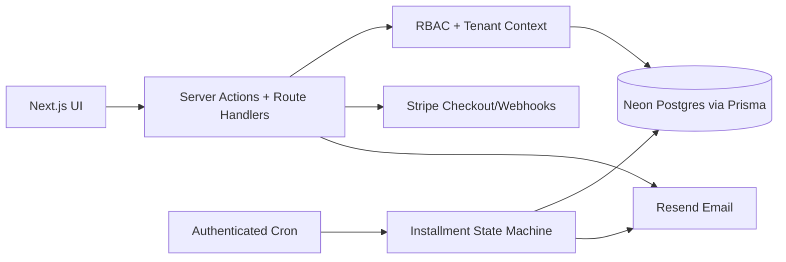

# BridalStack / StackCRM

A multi-tenant CRM prototype for bridal retail operations. It brings customer records, appointments, sales, inventory, contracts, public booking, installments, and role-aware workflows into one Next.js application.

[](https://github.com/yigiterturk-dev/stackcrm/actions/workflows/ci.yml)
[](https://nextjs.org/)
[](tests)
[](LICENSE)

> Status: the domain rules, TypeScript build, lint, and dependency audit are verified locally, and a 22-stage end-to-end suite runs against a live Neon Postgres database or an isolated migration database, depending on the stage. Stripe, Resend, Vercel Blob, and AI integrations are environment-gated and require owner-provided credentials.

## Product evidence

[](docs/screenshots/landing-desktop.png)

Current default-branch landing experience captured locally. External services remain environment-gated; the image is UI evidence, not proof of a hosted production deployment.

## Why this project exists

Bridal retail combines long customer journeys with scheduled fittings, physical inventory, deposits, installments, contracts, and staff-specific access. BridalStack explores how those workflows can share one tenant-scoped operating model without turning every user into an administrator.

## Engineering highlights

- **Fail-closed RBAC:** `owner`, `admin`, `stylist`, and `viewer` roles normalize unknown values to the least-privileged role.
- **Tenant isolation:** there is no row-level security to fall back on, so every query is filtered through a single gate (`getCurrentTenant` / `requireTenantId`) that throws rather than run unscoped.
- **Public booking guardrails:** UUID, contact, date, time-range, past-date, and overlap validation live in pure, testable functions.
- **Installment state machine:** deterministic plan generation, cent-preserving rounding, due-state derivation, and deduplicated reminder decisions.
- **Environment-gated services:** database, cron, email, payment, storage, and AI credentials stay server-side; a missing `NEXTAUTH_SECRET` fails the boot in production rather than falling back to a shared default.
- **Modular product surface:** feature packs control sales, inventory, booking, and management capabilities. Packs with no shipped module cannot be purchased, and the Stripe endpoint re-checks that server-side.

## Architecture



Authorization is layered: the proxy rejects unauthenticated requests to protected routes, while pages and API handlers enforce route-specific authentication, role, and tenant checks. Public booking, contract-signature, and customer-portal routes remain intentionally reachable through scoped tokens or validated inputs.

## Verified domain behavior

`npm test` covers 306 unit cases; `tests/e2e/` adds 324 checks across 22 stages against a running server, a live database, or an isolated migration database. Together they cover:

- booking happy paths, malformed tenant IDs, invalid time windows, past dates, missing contact data, and collision detection;
- role ranking, permission escalation denial, legacy-role normalization, and unknown-role fallback;
- installment splitting, rounding invariants, minimum counts, due/overdue transitions, and reminder selection.

Run the same quality gates used by CI:

```bash
npm ci --ignore-scripts
npx prisma generate
npm run lint
npm test
npm run build
npm audit --omit=dev --audit-level=high
```

## Local setup

Requirements: Node.js 24+, npm, and a Postgres database (Neon recommended).

```bash
git clone https://github.com/yigiterturk-dev/stackcrm.git
cd stackcrm
npm ci --ignore-scripts
npx prisma generate
cp .env.example .env.local   # then fill DATABASE_URL and NEXTAUTH_SECRET
npx prisma migrate deploy
npm run dev
```

Open `http://localhost:3000`. Every environment variable is documented in `.env.example`; optional integrations stay disabled until their server-only variables are supplied.

## Data and security notes

- Never expose the database URL, Stripe secrets, cron secrets, storage tokens, or AI keys to browser code.
- `NEXTAUTH_SECRET` is mandatory in production; the server refuses to start without it.
- The built-in public-route rate limiter is process-local; a distributed deployment should use a shared store such as Redis.
- Password reset and staff invitations issue single-use tokens; only the SHA-256 digest is stored, never the raw token.
- Installment reminders are implemented; automatic recurring card charging is explicitly not implemented.

See [SECURITY.md](SECURITY.md) for reporting and [docs/showcase-audit.md](docs/showcase-audit.md) for the evidence ledger and remaining production gates.

## Stack

Next.js 16 · React 19 · TypeScript · Prisma · Neon Postgres · NextAuth · Stripe · Resend · Vercel Blob · Tailwind CSS · Recharts · Node test runner

## License

[MIT](LICENSE)
